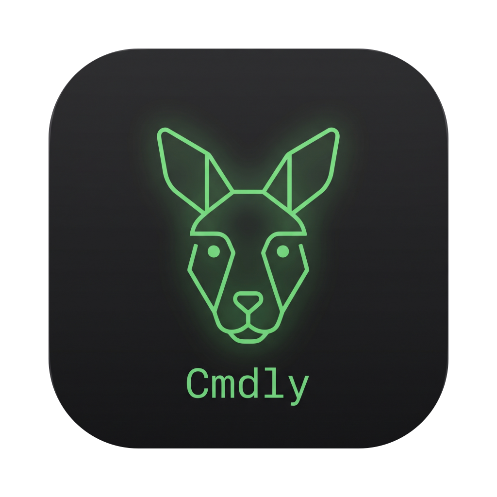
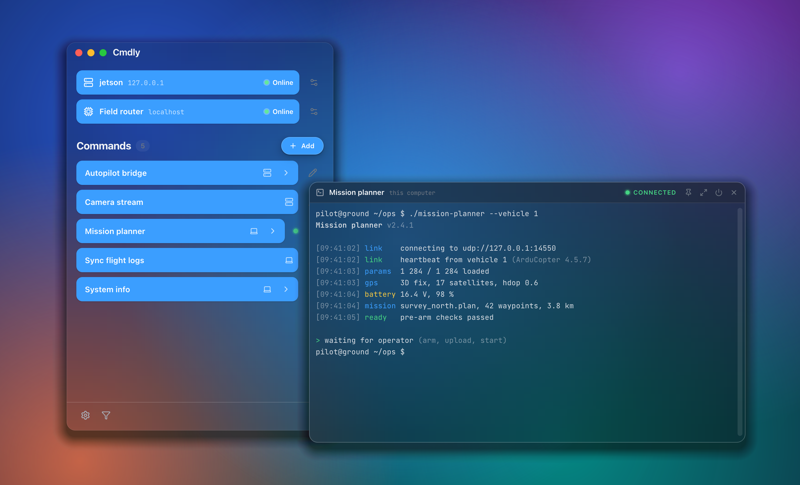
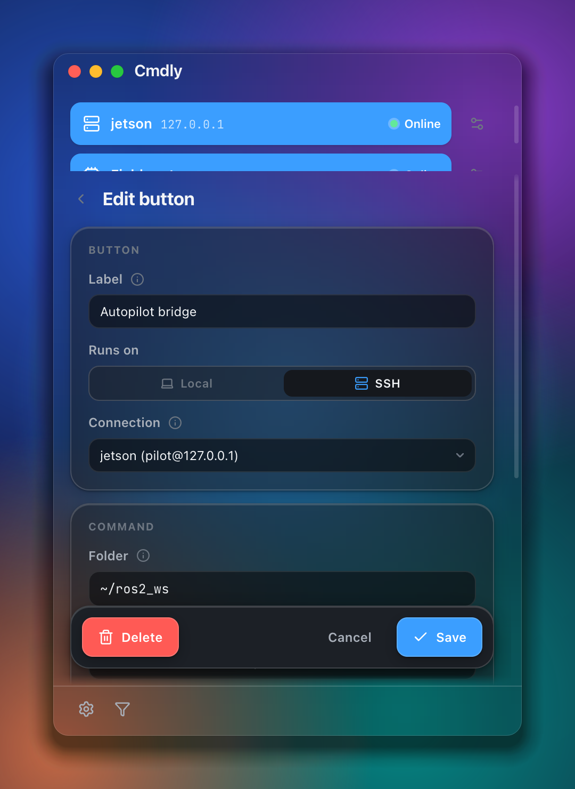
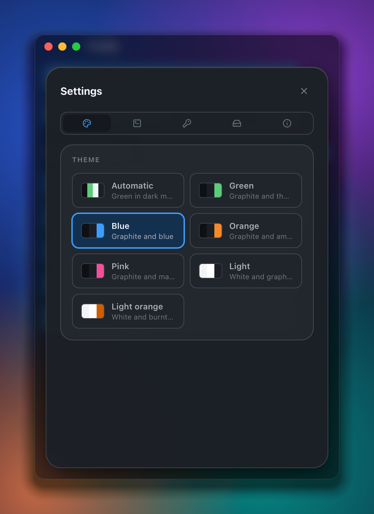
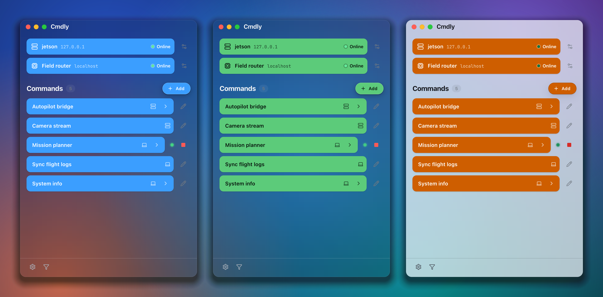

<p align="center">
  
</p>

<h1 align="center">Cmdly</h1>

<p align="center">
  <strong>One click instead of five terminals.</strong><br>
  Buttons for the programs you start again and again,<br>
  on this computer or over SSH on another one.
</p>

<p align="center">
  
  
  <a href="https://www.python.org/" target="_blank"></a>
  
  <a href="https://developer.mozilla.org/en-US/docs/Web/JavaScript" target="_blank"></a>
  
  
  
</p>

<p align="center">
  
</p>

---

## Why Cmdly?

If you work with a companion computer (a drone, a robot, a Raspberry Pi in the
field), you start the same commands every day: log in over SSH, change into the
folder, start the bridge, start the camera stream, fetch the logs. Cmdly turns
each of those commands into a button.

- **One click** starts a command in a real terminal or quietly in the background.
- **Local or over SSH**, with saved connections, a password or a key file.
- **At a glance**, whether your computers are reachable: each one is pinged, with its latency.
- **Real terminals** in windows of their own: Ctrl-C, `top`, `vim`, password prompts.

Cmdly was inspired by the SSH launcher plugin of
[Corvus GCS](https://github.com/M-BSquared/CorvusGCS) and grew into an app of
its own.

## Features

<table>
<tr>
<td width="50%" valign="top">

### Buttons for your commands

A label, a target (local or SSH), a folder and a command, with a live preview
of the line that actually runs. Reorder them by drag and drop.

- **Terminal mode:** one shell per button. Pressing it again runs the command
  there again, with Ctrl-C first if you like.
- **Background mode:** a child process locally, `nohup` over SSH.
- **The arrow** in a button starts the command and opens its terminal at once.
- While something runs, the row shows a green dot and a stop button.

</td>
<td width="50%" valign="top">

</td>
</tr>
<tr>
<td width="50%" valign="top">

</td>
<td width="50%" valign="top">

### Your computers at a glance

Every companion computer is a card at the top of the window with its status
(online with latency, checking, offline). Pressing the card of an SSH
connection opens a shell on it.

- Any saved SSH connection can be shown there with one switch.
- Ping-only computers (a router, a radio link) work too.
- **Filter:** hides what is offline right now, buttons and cards.
- Only what is shown at the top is pinged.

</td>
</tr>
</table>

### Feels at home

<p align="center">
  
</p>

Seven themes (Automatic, Blue, Green, Orange, Pink, Light, Light Orange). On
macOS the desktop shines through the frosted window, blurred behind it, the
title bar is part of the window and terminals are frosted glass. On Linux the
window is frosted too, tinted by the theme — and blurred behind where the
window manager can blur (KDE's KWin).

### And more

- **Terminal windows** as in Corvus: frameless, freely placeable, pinnable above
  Cmdly, draggable back into the main window. The scrollback is restored when
  you open one again.
- **Pinned on top:** a pin beside the filter in the status line keeps the
  window above other programs', as long as it is on.
- **Companion power menu:** right-click a companion computer up top and shut
  it down or reboot it — one command over its SSH connection, asked for
  before it goes.
- **Safe connections:** passwords stay in the backend (`~/.cmdly/config.json`,
  readable only by you) and never reach the page. When you change a connection,
  every button and card follows.
- **Import/export** of the whole setup, passwords optional.
- **Update notice** when a new release is out.

## Installation

Ready-made builds for macOS (`.dmg`) and Linux (`.AppImage`) are on the
[**Releases**](https://github.com/M-BSquared/Cmdly/releases) page.

Or run it from source (Python ≥ 3.12):

```bash
git clone https://github.com/M-BSquared/Cmdly.git
cd Cmdly
./run.sh
```

The first start creates `.venv` and installs the dependencies from
`pyproject.toml`; after that Cmdly starts without a network. On Linux,
`./run.sh --desktop-entry` adds the checkout to the app menu.

## Getting started

1. **Add a connection:** Settings → SSH → *Add a connection*. *Test* checks the
   login, *Show in the main window* puts the computer at the top.
2. **Add a button:** *Add* in the main window, then a target and a command.
3. **Press it.** The arrow in the button opens its terminal right away.

<details>
<summary><strong>Building it yourself</strong></summary>

| Platform | Command | Result |
| --- | --- | --- |
| macOS (arm64/x86_64) | `./build.sh --dmg` | `dist/Cmdly.app`, `dist/Cmdly-<version>-macOS-<arch>.dmg` |
| Linux (x86_64/aarch64) | `./build.sh` | `dist/Cmdly-<version>-<arch>.AppImage` |
| Linux AppImage from macOS | `tools/appimage-in-docker.sh x86_64` | as above, built in Docker |

- The macOS app bundles a relocatable framework Python, Qt and every
  dependency, signed ad hoc. With `CODESIGN_IDENTITY="Developer ID
  Application: …"` it is signed properly.
- The AppImage uses the current
  [`appimagetool`](https://github.com/AppImage/appimagetool) (pinned to 1.9.1,
  `CMDLY_APPIMAGETOOL_VERSION=continuous` for the newest build) with the static
  runtime, so the target system needs no `libfuse2`.
- An AppImage only runs on systems with at least the glibc of the build system.
  The PySide6 wheels need glibc 2.34 (x86_64) or 2.39 (aarch64), so x86_64 is
  built on Ubuntu 22.04 and aarch64 on Ubuntu 24.04;
  `tools/appimage-in-docker.sh` does exactly that.
- `tools/qt_bundle.py` removes every Qt module Cmdly does not load (about a
  third of PySide6) and fails if a library would be missing afterwards.

</details>

<details>
<summary><strong>How it is built</strong></summary>

A Python backend (`ThreadingHTTPServer`, on 127.0.0.1 only) and a web
interface in a PySide6/QtWebEngine window, as in Corvus GCS. Terminals use one
WebSocket per window and xterm.js.

```
cmdly/          Python: backend (server.py), Qt windows (app.py),
                SSH bridge, local PTY shell, WebSocket, ping, config
  routes/       further API routes (import/export)
src/            web interface
  css/          themes.css (all tokens) → components.css → base/app/windows.css
  js/           ui.js (components), store/launch/shelf/companion/settings …
  vendor/       xterm.js, Lucide, fonts (offline)
assets/         app icon
docs/images/    the pictures of this README
tools/          make_icon.py, readme_shots.py (README pictures and social
                preview), qt_bundle.py, appimage-in-docker.sh
tests/          pytest (tests/test_*.py) and Node (tests/test_frontend_*.js)
```

</details>

<details>
<summary><strong>Developing and testing</strong></summary>

```bash
.venv/bin/python -m pytest
for f in tests/test_frontend_*.js; do node "$f"; done
.venv/bin/ruff check cmdly tests tools
```

The pictures of this README come from `tools/readme_shots.py`: it starts Cmdly
with a made-up demo setup in a temporary `CMDLY_HOME`, has Chromium draw each
window at twice the resolution and lays it onto a generated wallpaper with
frosted glass and a shadow. It records nothing from the screen and shows none
of your own computers or buttons.

```bash
.venv/bin/python tools/readme_shots.py            # every picture
.venv/bin/python tools/readme_shots.py hero       # only some of them
```

Settings live in `~/.cmdly/config.json`; the configuration of the old PySide
widgets version is picked up on the first start.

</details>
